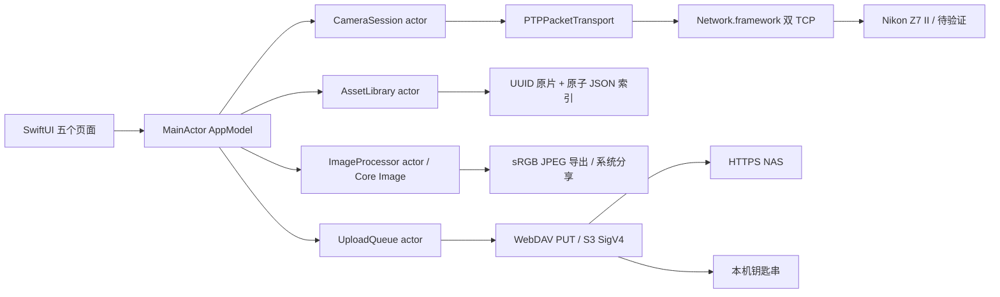
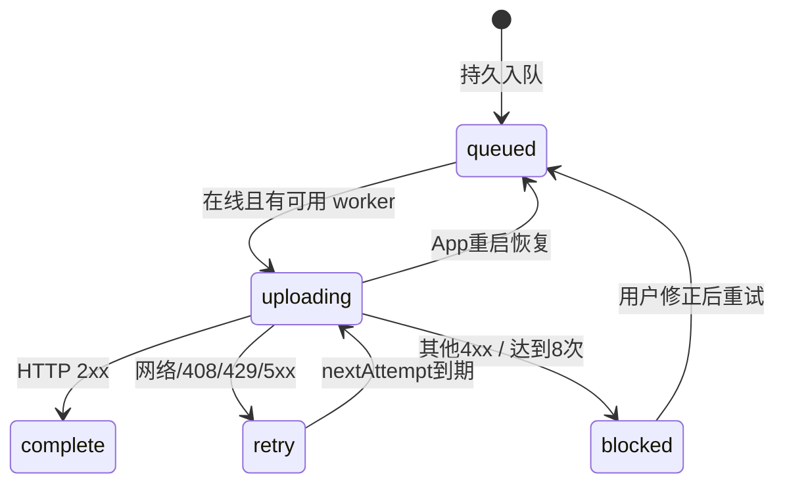

# 架构与数据流程

## 分层

`ZoraCore` 是 Swift 6 包：协议编解码、`CameraSession` actor、属性/对象解析、`AssetLibrary` actor、`UploadQueue` actor、纯 Swift SHA256/HMAC/SigV4、Recipe/LUT/监看分析。只依赖 Foundation；Windows/Linux 可测试。

iOS 使用 `Network.framework` 的双 TCP 通道，通过 `PTPPacketTransport` 注入核心会话。UI 通过 `@MainActor @Observable AppModel` 协调 actor，SwiftUI 采用系统 Tab/NavigationStack/Form/Sheet 和原生 `glassEffect`。Core Image 在独立 actor 中解码/渲染；避免在 UI 线程处理照片。

## 相机状态与并发

连接成功需要两通道 ACK、可解析的 Nikon GetDeviceInfo 与成功的 OpenSession。操作按 actor 内的 busy guard 串行化：actor 可重入，但等待网络期间第二个操作会得到 busy，而不会交错事务。生产调用无自动快门重试。Live View 循环每帧等待图像及处理后再拉取下一帧，天然背压；停止时等待当前帧，再发 EndLiveView。相机/命令通道超时取消连接，避免迟到应答污染下一次请求。事件通道允许闲置，不对正常静默施加读超时。

每次关闭更换 generation，防止旧事件任务的失败回调误关新连接。事件实际接收但未用于自动照片发现。程序暂停/网络失败后 UI 状态与会话状态可能暂时有差异，下一次操作会得到 disconnected，需重新连接；不能用残留“已连接”标签作为硬件健康证明。

## 文件与编辑

Files 安全作用域 → 原片复制到 Application Support/Originals → UUID 文件名避免重名覆盖 → index 原子落盘。原片导入失败时回滚新复制文件。索引解析错误会显式报错，不把资料库静默重置为空。

编辑为 Recipe 数值，Core Image 对预览/导出应用；原片不修改。JPEG 导出后持久记录 Recipe。NEF 解码依赖 iOS 支持，不实现 Nikon SDK 私有 RAW 引擎；预览失败仍可备份原片。LUT 标准 red-fastest 顺序装配 RGBA Float32，用 `CIColorCube`；仅接受标准域和 0…1 数值，不自动猜测 Log 色彩空间。

## 上传状态机

每次状态变化先原子写 JSON，再更新内存。上传等待时允许入队，单 worker guard 防止重复 drain。文件路径和目的地写队列；凭据只写钥匙串、队列保存 credentialID。更换目的地时创建独立 credentialID，既有任务保留原目的地；保存相同目的地时更新同一凭据引用，允许修正密码后重试。当前没有清理历史凭据功能；须在后续加入队列引用计数后清理。

稳定 object key 实现重复 PUT 的幂等性；不是 exactly-once，网络断在服务端写入后而客户端未收到响应时会再次 PUT。2xx 表示服务器确认请求成功；没有远端哈希复核、WebDAV MKCOL、S3 multipart、分片续传或 HTTP 级条件写。当前前台定时检查与回前台恢复，iOS 不保证后台执行时间。大文件摘要实现会有额外内存复制，S3 上限256 MiB；需性能测试后改为流式摘要与 multipart。

TLS 使用系统校验，不接受任意证书；拒绝重定向防止凭据转发与签名路径错配。无查询串/URL 内凭据；用户名密码不写日志。原片与队列尚未显式设置 NSFileProtection/备份排除策略，应按最终恢复需求在真机验收前确定。

## 测试分界

- 核心 XCTest 验证实际生产核心代码，包括报文碎片、事务错配、签名向量、队列重启与原片保留。
- `ScriptedTransport` 仅用于 Tests，验证实际 CameraSession 的操作顺序；不宣称与 Nikon 硬件互通。
- 原生 UI 测试与 Core Image 图像一致性、钥匙串/权限、Wi-Fi entitlement 需 Xcode/iPhone。
- HTTPS 可选集成测试需用户控制且系统信任证书的服务；真实 NAS/WebDAV/S3 尚未配置，因此不宣称上传验收完成。
